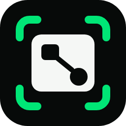

# Aurora Board



Lousa digital pessoal, privada e local. Feita para aula e projeção: formas, setas que se ligam às
formas, texto, caneta, borracha, atalhos de teclado, salvamento automático no navegador e exportação
em PNG, SVG e JSON.

- **Sem conta, sem servidor, sem nuvem.** Os quadros ficam no IndexedDB do seu navegador, na sua máquina.
- **Sem analytics, telemetria, anúncios ou chamadas para fora.** As fontes vêm dentro do build.
- **Você não fica preso:** tudo exporta em JSON legível (e volta pela importação), PNG ou SVG.

Stack: React 19 + TypeScript + Vite 8 + IndexedDB (via [`idb`](https://github.com/jakearchibald/idb)).
Testes: Vitest (unidade) e Playwright (ponta a ponta).

---

## Instalar no Windows (app de desktop)

O jeito mais simples de usar: um instalador que põe o Aurora Board no Menu Iniciar e na área de trabalho.
A lousa abre numa janela própria, sem barra de navegador, e funciona sem internet.

O instalador pronto de cada versão fica na página **Releases** do repositório no GitHub
(`AuroraBoard-Setup-<versão>.exe`, com o `.sha256` ao lado). Para gerar você mesmo:

1. Gere o instalador (uma vez por versão). Abra o PowerShell (tecla Windows → `PowerShell` → Enter) e cole
   uma linha por vez:
   ```powershell
   cd C:\Desenvolvimento\aurora-board
   npm run installer
   ```
   No fim aparece `Pronto:` com o caminho `release\AuroraBoard-Setup-0.1.0.exe`.
2. Dê dois cliques nesse arquivo e siga o assistente. Não pede administrador.
3. Abra pelo atalho **Aurora Board** (área de trabalho ou Menu Iniciar).

| O quê | Onde |
|---|---|
| Programa | `%LOCALAPPDATA%\Programs\Aurora Board\AuroraBoard.exe` |
| Quadros e preferências | `%LOCALAPPDATA%\AuroraBoard\` (perfil do WebView2, com o IndexedDB) |
| Desinstalar | Configurações → Aplicativos → Aurora Board. Ele **pergunta** se apaga os quadros; o padrão é não apagar |

Como funciona: o `AuroraBoard.exe` (Go, ~8 MB, sem dependências) leva a lousa dentro dele, sobe um servidor
só em `127.0.0.1:47180` (com a mesma CSP do `npm start`) e abre a janela com o **WebView2**, o motor do Edge que
já vem no Windows 11. Fechar a janela encerra tudo. Abrir o atalho de novo com o app aberto só traz a janela
para a frente. O botão de tela cheia põe a janela inteira em tela cheia (para o projetor).

> Os quadros do app de desktop ficam separados dos do navegador (`npm start`): são perfis diferentes. Para levar
> de um para o outro, use **Quadros → Exportar todos (backup)** de um lado e **Importar arquivo** do outro.

O instalador não é assinado digitalmente. Gerado e usado nesta máquina, o Windows não reclama; se o arquivo for
baixado da internet em outro PC, o SmartScreen mostra "O Windows protegeu o computador" (**Mais informações →
Executar assim mesmo**).

Para gerar só o executável, sem instalador: `npm run desktop` (sai em `release\app\AuroraBoard.exe`).
Pré-requisitos para gerar: Node 22.12+, Go 1.22+ e Inno Setup 6 (`winget install JRSoftware.InnoSetup`).

## Como rodar no navegador (desenvolvimento)

Pré-requisito: **Node.js 22.12 ou mais novo** (`node -v` para conferir).

Abra o PowerShell (tecla Windows → digite `PowerShell` → Enter) e cole uma linha por vez:

```powershell
cd C:\Desenvolvimento\aurora-board
npm run setup
```

O `setup` instala as dependências e baixa o Chromium que o teste ponta a ponta usa (~170 MB, uma vez só).
Deu certo se terminar sem nenhuma linha começando com `npm ERR!` ou `Error:`.

### Uso do dia a dia (modo produção local)

```powershell
npm start
```

Gera o build e abre um servidor em **http://127.0.0.1:4180**. Abra esse endereço no navegador.
Para parar: `Ctrl+C` no PowerShell. Se o build já existe, `npm run serve` sobe o servidor direto.

> **Use sempre o mesmo endereço.** O navegador guarda os quadros separados por endereço e porta:
> o que você desenhar em `127.0.0.1:4180` não aparece em `localhost:4180` nem em `127.0.0.1:5173`.
> Mudou de porta? Exporte um backup no endereço antigo e importe no novo.

### Todos os scripts

| Comando | O que faz |
|---|---|
| `npm run setup` | Instala dependências + Chromium do Playwright |
| `npm run dev` | Servidor de desenvolvimento com recarga automática (http://127.0.0.1:5173) |
| `npm test` | Testes de unidade (modelo de dados, fluxo principal, IndexedDB, validação, atalhos) |
| `npm run test:e2e` | Teste ponta a ponta no Chromium, contra o build de produção com as cabeceiras de segurança |
| `npm run typecheck` | Checagem de tipos do TypeScript |
| `npm run build` | Typecheck + build de produção em `dist/` |
| `npm start` | Build + servidor local de produção (http://127.0.0.1:4180) |
| `npm run serve` | Só o servidor de produção (precisa de um build feito) |
| `npm run preview` | O preview do Vite (http://127.0.0.1:4173), com as mesmas cabeceiras de segurança (precisa de um build feito) |
| `npm run check` | Testes de unidade + build + teste ponta a ponta, em sequência |
| `npm run desktop` | Gera o app de desktop do Windows em `release\app\AuroraBoard.exe` (inclui `go vet` e `go test`) |
| `npm run installer` | O mesmo + o instalador `release\AuroraBoard-Setup-<versão>.exe` e o `.sha256` |
| `npm run icons` | Regenera os ícones (`.ico`, recurso do `.exe`, favicon) a partir de `design/marca/icone.svg` |

### Configuração (`.env`)

O app **não usa nenhuma chave, token ou credencial** — não existe integração externa. O `.env.example`
só documenta as portas. Para mudar alguma, copie para `.env` e edite:

```powershell
Copy-Item .env.example .env
```

---

## Como usar

| Ação | Como |
|---|---|
| Desenhar forma | `R` retângulo, `O` elipse, `D` losango (ou `2` `3` `4`) e arraste. Clique sem arrastar = tamanho padrão |
| Conectar | `A` (seta) e arraste de uma forma até outra. As pontas ficam ligadas e acompanham as formas. Ou selecione duas formas e clique em **Conectar com seta** |
| Escrever | `T` e clique; ou clique duplo na lousa. Numa forma, clique duplo ou `Enter` edita o rótulo. `Esc` conclui |
| Caneta / borracha | `P` / `E` |
| Mover, redimensionar | Arraste o elemento; arraste as alças. `Shift` mantém a proporção |
| Desfazer / refazer | `Ctrl+Z` / `Ctrl+Shift+Z` |
| Zoom | `Ctrl` + roda do mouse, `Ctrl+=` / `Ctrl+-`, `Shift+1` enquadra tudo |
| Mover a lousa | Roda do mouse, `H`, ou segure `Espaço` e arraste |
| Projeção | **Modo foco** (`Alt+Z`) esconde os painéis; o botão de tela cheia fica no canto inferior direito |
| Tema escuro | Botão de sol/lua no canto inferior direito, ou `Alt+Shift+D`. Fundo cinza, não preto |

A lista completa fica no app: tecla `?`.

**Só teclado:** `Tab` com o foco na lousa percorre os elementos (e sai da lousa depois do último);
setas movem, `Enter` edita o texto, `Delete` apaga. Acionar um botão de forma pelo teclado (`Enter`
no botão) insere a forma no centro da tela, já selecionada. Um leitor de tela ouve o que foi selecionado
e criado.

**Quadro de exemplo:** no estado vazio, ou em **Quadros → Criar quadro de exemplo**. Ele aparece com a
etiqueta *Exemplo*, avisa na própria lousa que pode ser apagado, e sai em **Quadros → ícone da lixeira**.

---

## Permissões

O app não pede nenhuma permissão ao abrir. Ele usa:

| Recurso do navegador | Para quê | Quando |
|---|---|---|
| IndexedDB | Guardar os quadros | Sempre (se o navegador bloquear, ver "Modo temporário" abaixo) |
| Downloads | Salvar PNG, SVG e JSON exportados | Quando você exporta |
| Seletor de arquivo / arrastar e soltar | Importar um `.aurora.json` | Quando você importa |
| Área de transferência (eventos `copy`/`paste`) | Copiar e colar elementos e texto | Quando você usa `Ctrl+C`/`Ctrl+V`; não usa a API que pede permissão |
| Tela cheia | Projeção | Quando você clica no botão |
| Armazenamento persistente (`navigator.storage.persist`) | Pedir ao navegador para não limpar os quadros quando o disco enche | Só se você clicar em **Quadros → Pedir ao navegador para manter os dados**. O Firefox pode perguntar; o Chrome decide sozinho |

Nada de câmera, microfone, localização, notificações ou cookies.

---

## Onde ficam os dados

- **Banco:** IndexedDB chamado `aurora-board`, com três tabelas: `boards` (nome, datas, vista, contagem),
  `contents` (os elementos de cada quadro) e `settings` (último quadro aberto, grade ligada/desligada, tema).
- **Tema:** além do `settings`, fica uma cópia no `localStorage` (chave `aurora-board:theme`), só para a página já
  abrir no tema certo, sem piscar. Ela é a mais recente; o IndexedDB vale quando ela não existe.
- **Onde no disco:** dentro do perfil do navegador, separado por endereço. No Chrome do Windows, por exemplo:
  `%LOCALAPPDATA%\Google\Chrome\User Data\Default\IndexedDB\http_127.0.0.1_4180.indexeddb.leveldb`.
  Não edite esses arquivos à mão.
- **Quem vê:** só esse perfil do navegador nessa máquina. Não há sincronização; outro navegador, outro
  perfil ou janela anônima começam vazios.
- **O que apaga os dados:** "Limpar dados de navegação" com *cookies e dados de sites* marcado, desinstalar
  o navegador, ou o próprio navegador quando o disco fica cheio (a menos que o armazenamento esteja marcado
  como persistente).

### Modo temporário (degradado)

Se o navegador não liberar o IndexedDB (alguns modos privativos, ou sites bloqueados nas configurações), o
app continua funcionando, mas **só na memória da aba**: aparece a faixa vermelha avisando, o indicador mostra
*Sem salvamento*, e fechar a aba pede confirmação. Nesse modo, exporte em JSON antes de sair.

---

## Backup e restauração

- **Um quadro:** Exportar → *Arquivo do quadro (.aurora.json)*, ou o ícone de download na lista de Quadros.
- **Tudo:** Quadros → **Exportar todos (backup)** gera `aurora-board-backup-AAAA-MM-DD.aurora.json`.
- **Restaurar:** Quadros → **Importar arquivo** (ou arraste o arquivo para a lousa). A importação **nunca
  sobrescreve**: cada quadro do arquivo vira um quadro novo, com identificadores novos.
- **Levar para outro computador:** exporte lá, importe aqui. É também o jeito de passar um quadro para outra pessoa.

O `.aurora.json` é JSON legível (formato `aurora-board`, versão 1): uma lista de quadros, cada um com nome,
vista e elementos (`rectangle`, `ellipse`, `diamond`, `text`, `arrow`, `line`, `freedraw`). Dá para versionar
no git.

---

## Arquitetura

```
src/
  model/        núcleo puro, sem React nem navegador (é o que os testes de unidade cobrem)
    types.ts        tipos dos elementos, quadro, vista e estilo
    geometry.ts     caixas, clique em forma/borda, seleção por área, ponto de encaixe da seta, alças
    operations.ts   mover, redimensionar, apagar, duplicar, colar, camadas, estilo, texto, ligar setas
    history.ts      desfazer/refazer por fotografias imutáveis
    validate.ts     validação de tudo que vem de fora (arquivo, área de transferência, banco)
    fileFormat.ts   formato .aurora.json e da área de transferência
    sample.ts       quadro de exemplo
    text.ts         medida de texto e limpeza de caracteres de controle
  editor/
    editorState.ts  reducer do quadro aberto (elementos, seleção, ferramenta, vista, histórico)
    Canvas.tsx      a lousa em SVG: ponteiro, roda, teclado → operações do modelo
    TextEditor.tsx  caixa de texto sobre a lousa
    shortcuts.ts    mapa de atalhos (função pura)
    viewport.ts     conversão tela ↔ mundo, zoom no cursor, enquadrar
  render/ElementView.tsx   desenho SVG de cada elemento — o mesmo na tela e na exportação
  export/          SVG (com fontes embutidas), PNG (SVG rasterizado num canvas), downloads
  storage/repository.ts   IndexedDB (e o repositório em memória do modo temporário)
  ui/              barra de ferramentas, painel de estilo, diálogos, avisos, estado vazio
  App.tsx          inicialização, salvamento automático, atalhos globais, copiar/colar, importar/exportar
scripts/serve.mjs  servidor estático de produção (só 127.0.0.1, cabeceiras de segurança)
scripts/build-desktop.mjs  monta o app de desktop e o instalador
scripts/icons.mjs  gera o .ico e o .syso (recurso de ícone do .exe) sem ferramenta externa
desktop/           app de desktop em Go: servidor embutido (server.go) e janela WebView2 (main_windows.go)
installer/         script do Inno Setup (por usuário, sem administrador)
design/marca/      a marca: icone.svg é a fonte de todos os ícones
tests/unit/        Vitest: geometria, operações, validação, fluxo principal, IndexedDB (fake-indexeddb)
tests/e2e/         Playwright: o teste de fumaça do ciclo completo
```

Decisões que valem saber:

- **SVG, não canvas.** A lousa é um `<svg>` renderizado pelo React. A exportação SVG/PNG reaproveita o mesmo
  componente (`ElementView`), então o arquivo sai igual à tela. O PNG é o SVG rasterizado em 1×, 2× ou 3×.
- **Estado imutável.** Cada operação devolve uma lista nova reaproveitando os objetos que não mudaram; o
  desfazer guarda essas listas (até 200 passos, só na memória da aba).
- **Setas ligadas** guardam o id da forma em cada ponta. Ao mover/redimensionar uma forma, as pontas são
  recalculadas na borda (retângulo, elipse e losango têm a borda exata). Arrastar a seta sozinha a solta.
- **Salvamento automático** meio segundo depois da última alteração, em fila (nunca duas gravações ao mesmo
  tempo), e de novo ao esconder ou fechar a aba.
- **Segurança:** todo arquivo importado passa por `validate.ts` (tipos, números finitos e limitados, cores só
  `#rrggbb`, textos sem caracteres de controle e com limite de tamanho, até 20 mil elementos e 25 MB). Os ids
  são trocados na importação. O servidor de produção manda CSP estrita (`default-src 'self'`, sem script nem
  estilo inline), `nosniff`, `no-referrer` e escuta só em `127.0.0.1`. O app não registra conteúdo dos quadros
  no console.

### Design

**Marca:** a "lousa recortada", escolhida pelo Mauro em 26-nov-2026: os colchetes de canto verdes do design system
Aurora em volta de uma lousa cheia com um diagrama vazado (duas formas ligadas), sobre o ladrilho preto dos ícones
dos sistemas Aurora. Fonte única: `design/marca/icone.svg`; dentro do app, a lousa da marca segue o tema.

Design system Aurora (v1.1) numa versão clara, pensada para projetor: o preto do sistema recua para o
texto, a lousa é papel `#F5F7F5` com grade de pontos, os painéis são cartões brancos. O verde `#00E676`
marca ação e estado escolhido (sempre com texto preto em cima); foco e anéis usam o verde profundo `#0F3D2E`;
vermelho só para erro e risco, sempre com texto. Fontes Space Grotesk (títulos), Inter (interface e texto
normal) e IBM Plex Mono (atalhos e código), embutidas no build. As cores de traço da lousa têm contraste
≥ 4,5:1 sobre branco. Padrões grandes de propósito: traço médio de 4 px e texto de 28 px.

**Tema escuro:** fundo cinza `#2B312E` (não preto) e painéis `#353C39`; foco e anéis passam ao verde vivo. O quadro
guarda sempre as cores "do tema claro"; no escuro, cada cor da paleta é desenhada com uma versão própria
(`src/model/theme.ts`): traços com contraste ≥ 5,8:1 sobre o cinza, preenchimentos em tons escuros do mesmo matiz.
O rótulo sobre o verde Aurora troca sozinho para tinta escura. Cores fora da paleta (vindas de arquivo importado)
têm a luminosidade invertida. Na exportação PNG/SVG dá para escolher o tema da imagem; o JSON não muda.

---

## Limitações (o que este app não faz)

- **Não é colaborativo em tempo real.** É de uma pessoa, num navegador. Compartilhar = exportar o arquivo.
  Duas abas abertas no mesmo quadro não se sincronizam: vale a última que salvar.
- **Ficou de fora de propósito:** biblioteca de modelos, importação/exportação de alta fidelidade (não abre
  arquivos do Excalidraw, PDF ou PowerPoint), modo apresentação com slides, contas, permissões e qualquer
  recurso de empresa.
- Sem rotação de elementos, setas curvas ou em cotovelo, rótulo em seta, imagens coladas, agrupamento,
  travar elemento, quebra automática de linha no texto e traço "desenhado à mão".
- Desfazer não sobrevive a recarregar a página.
- Zoom por pinça em tela sensível ao toque não é tratado (a caneta e o toque funcionam para desenhar;
  o zoom fica nos botões).
- O PNG tem limite de tamanho do navegador (lado até 16 000 px): em quadros enormes a escala é reduzida
  automaticamente.
- O texto exportado usa as fontes embutidas no próprio SVG; programas que não leem `@font-face` dentro de SVG
  mostram a fonte do sistema.
- Testado só no Chromium (Chrome/Edge). Firefox e Safari não foram testados.
- O app de desktop é só para Windows 10/11 x64 e usa a porta 47180 (fixa: os quadros dependem dela). Se outro
  programa ocupar essa porta, o app avisa e não abre. O instalador não é assinado digitalmente.

## Licença

Código aberto sob a licença **MIT** (`LICENSE`): use, modifique e distribua à vontade, mantendo o aviso de
copyright. Isso inclui a marca (`design/marca/`). Os componentes de terceiros e as licenças deles estão em
`THIRD_PARTY_NOTICES.md` (as fontes Inter, Space Grotesk e IBM Plex Mono são OFL).
